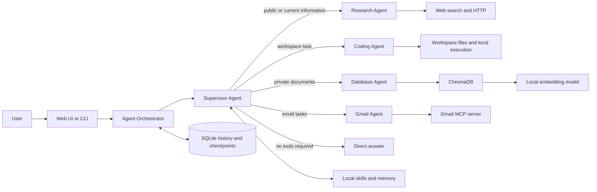
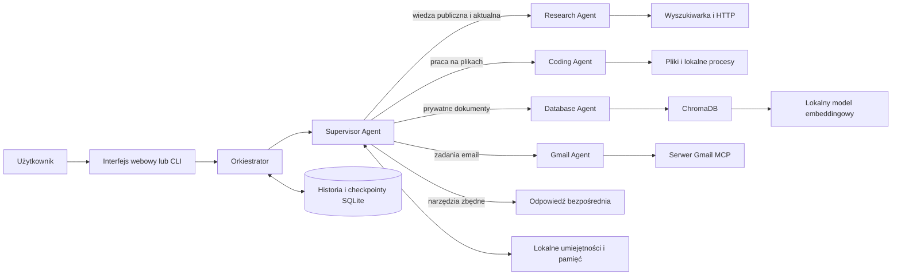

# Platon

> A privacy-oriented, local multi-agent system for document analysis with Retrieval-Augmented Generation (RAG).

[English](#english) · [Polski](#polski)

---

# English

## Overview

Platon is a local AI assistant designed to search, analyse, compare, and summarise private document collections. It combines a locally hosted language model with semantic retrieval and an agentic decision layer. Instead of running RAG for every message, the supervisor decides whether a request can be answered directly or should be delegated to a specialist with access to the appropriate tools.

The project is being developed as part of an engineering thesis titled **“Design and implementation of an agent system for document analysis using a local language model and RAG.”** Its main goals are useful document analysis, transparent tool use, persistent conversations, and keeping private document content on infrastructure controlled by the user.

> [!NOTE]
> The current application uses an `aiohttp` backend and a responsive browser interface. FastAPI and Electron belong to the proposed/future architecture and are not part of the current implementation.

## Key features

- Local inference through [Ollama](https://ollama.com/).
- Dynamic decision between a direct answer and specialist delegation.
- Semantic search over persistent ChromaDB collections.
- Ingestion of text-based PDF, DOCX, and TXT documents.
- Separate supervisor, document, research, coding, and Gmail responsibilities.
- Optional Gmail integration through a stdio MCP server with explicit tool filtering and human approval for mutations.
- Streaming responses and tool progress in the web interface.
- Persistent conversation history and LangGraph checkpoints in SQLite.
- Human approval before sensitive actions such as document ingestion, file mutation, command execution, or HTTP POST.
- Clarification requests, interrupted-run resume, retry, cancellation, and a FIFO request queue.
- Local skills and file-backed agent memory.
- Terminal and responsive web chat interfaces.

## Architecture



The system follows a supervisor–specialist pattern:

- **Supervisor Agent** interprets the request, decides whether tools are needed, delegates bounded tasks, combines evidence, and asks the user for clarification when necessary.
- **Database Agent** is the only specialist with access to the private vector store. It discovers documents, ingests them after approval, searches one or all collections, and returns document metadata with retrieved fragments.
- **Research Agent** searches public sources and reads HTTP resources when the request requires current or external information. It cannot access private collections or workspace files.
- **Coding Agent** reads and modifies workspace files, performs calculations, and runs local commands. It cannot browse the web or query the private document database.
- **Gmail Agent** uses the configured Gmail MCP server for narrowly delegated email work. Read-only tools are allow-listed; sending, drafts, replies, labels, attachments, and unknown tools require human approval.

This separation limits unnecessary data exposure and gives each specialist only the tools required by its role.

## How a request is processed

1. The user sends a message through the web interface or terminal client.
2. `AgentOrchestrator` associates the request with a persistent conversation thread.
3. The supervisor analyses the intent and either answers directly or delegates the task.
4. If private document knowledge is required, the Database Agent selects a collection and performs semantic retrieval.
5. Retrieved chunks, similarity scores, and metadata such as document name and page number are returned as evidence.
6. For email tasks, the supervisor delegates to Gmail Agent, which discovers tools from the configured MCP server and pauses before mutations.
7. The supervisor prepares the final response and the application stores the visible history and execution checkpoint.

Dependent specialist calls are executed in sequence so that, for example, research or database findings can be passed to the Coding Agent when an output file must be created.

## RAG pipeline

```text
PDF / DOCX / TXT
        │
        ▼
text extraction
        │
        ▼
recursive chunking (1,000 characters, 100-character overlap)
        │
        ▼
Qwen3-Embedding-0.6B embeddings (local CPU inference)
        │
        ▼
persistent ChromaDB collection
        │
        ▼
semantic similarity search
        │
        ▼
document chunks + provenance supplied to the Database Agent
```

The embedding model is loaded lazily and cached for the process lifetime. Reading a missing collection produces an error; only an explicit ingestion operation is allowed to create a new collection. PDF provenance includes page and chunk numbers, while DOCX and TXT results include document and chunk identifiers.

Chunk settings, optional ranking/reranking, document reuse, guarded page reads, and separate subagent models are described in [RAG configuration](docs/rag-tuning.md).

## Technology stack

| Area | Technology |
|---|---|
| Local language models | Ollama, `ChatOllama` |
| Agent orchestration | LangChain, LangGraph, Deep Agents |
| Validation and configuration | Pydantic |
| Vector database | ChromaDB |
| Embeddings | Sentence Transformers, Qwen3-Embedding-0.6B |
| Document processing | pypdf, python-docx, LangChain text splitters |
| Backend and streaming API | aiohttp, NDJSON |
| Persistence | SQLite, LangGraph SQLite checkpointer |
| Frontend | Embedded HTML, CSS, and JavaScript |
| Environment and packaging | Python 3.13, uv, setuptools |

## Requirements

- Python `3.13`
- [uv](https://docs.astral.sh/uv/)
- [Ollama](https://ollama.com/)
- Enough RAM or VRAM for the selected models
- Internet access during initial model downloads and when using the Research Agent

The default configuration uses `ornith-1.5:35b` for the supervisor, `qwen3.5:2b` for the specialists, and `Qwen/Qwen3-Embedding-0.6B` for embeddings. Smaller language models reduce hardware requirements but may be less reliable at tool selection and multi-step delegation.

## Installation

```powershell
git clone <repository-url>
cd platon
uv sync --locked --python 3.13
ollama pull ornith-1.5:35b
ollama pull qwen3.5:2b
```

The cross-platform helper can install Ollama and prepare the selected models:

```powershell
python setup_ollama.py --models ornith-1.5:35b qwen3.5:2b --write-env
```

For remote Linux/Ollama setups and SSH tunnelling, see [docs/ollama-installation.md](docs/ollama-installation.md).

## Configuration

Create a `.env` file in the repository root. A minimal configuration is:

```dotenv
OLLAMA_BASE_URL=http://127.0.0.1:11434
OLLAMA_MODEL=gemma4:26b-a4b-it-qat
OLLAMA_NUM_CTX=16384
CHROMA_PERSIST_DIR=./chroma_data
AGENT_BACKEND_ROOT=./.platon/agent
AGENT_WORKING_DIR=./.platon/agent
AGENT_SQLITE_PATH=./.platon/agent/agent_threads.sqlite3
AGENT_CHAT_UI_HOST=127.0.0.1
AGENT_CHAT_UI_PORT=8080
PLATON_LOG_LEVEL=INFO
```

| Variable | Purpose | Default |
|---|---|---|
| `OLLAMA_BASE_URL` | Ollama API address | `http://localhost:11434` |
| `OLLAMA_MODEL` | Supervisor model | `gemma4:26b-a4b-it-qat` |
| `OLLAMA_NUM_CTX` | Requested model context window | `16384` |
| `CHROMA_PERSIST_DIR` | ChromaDB persistence directory | `./chroma_data` |
| `AGENT_BACKEND_ROOT` | Virtual filesystem, skills, memory, and document root | `./.platon/agent` |
| `AGENT_WORKING_DIR` | Workspace exposed to the Coding Agent | `./.platon/agent` |
| `AGENT_SQLITE_PATH` | Conversation and checkpoint database | `./.platon/agent/agent_threads.sqlite3` |
| `AGENT_SYSTEM_PROMPT` | Supervisor prompt filename | `react_prompt.md` |
| `AGENT_MAX_HISTORY_MESSAGES` | Recent messages supplied to the model | `24` |
| `AGENT_CHAT_UI_HOST` | Web interface bind address | `127.0.0.1` |
| `AGENT_CHAT_UI_PORT` | Web interface port | `8080` |
| `PLATON_LOG_LEVEL` | Application log level | `INFO` |

The specialist model is currently configured in `AgentConfig.subagent_model_name`, rather than through an environment variable.

### Optional Gmail integration

Gmail support is disabled unless a local `.mcp.json` file configures an MCP server named `gmail`. The repository includes a stdio example that launches `@artymclabin/gmail-mcp@1.2.3` with `npx`; the server package and its OAuth flow are external to Platon. Start with the checked-in shape:

```json
{
  "mcpServers": {
    "gmail": {
      "command": "npx",
      "args": ["-y", "@artymclabin/gmail-mcp@1.2.3"]
    }
  }
}
```

Authenticate the Gmail MCP server according to its own documentation before delegating the first email task. Do not put OAuth tokens, client secrets, passwords, or personal credentials in `.mcp.json`; keep them in the server's supported local credential store or environment and out of version control. Platon starts the server lazily, discovers its tools, and supports only stdio transport. `allowedTools` and `disabledTools` can restrict exposure, but cannot be used together.

Gmail reads are allow-listed. Sending, replies, draft creation, label/filter changes, attachment downloads, and any unknown tool require an approval decision in the UI. Email bodies are untrusted input; never approve an action solely because an email asks for it.

## Running the application

Start the browser interface:

```powershell
uv run --locked python run_agent_chat_ui.py
```

Then open [http://127.0.0.1:8080](http://127.0.0.1:8080). Alternatively, use the terminal client:

```powershell
uv run --locked python -m platon.run_agent_chat
```

With GNU Make available:

```powershell
make build
make run
```

`make run` checks the local Ollama endpoint, starts `ollama serve` when necessary, and launches the web interface.

## Working with documents

Place documents in `.platon/agent/documents/`. Supported formats are `.pdf`, `.docx`, and `.txt`. Ask the assistant to ingest a document into a named collection; because ingestion changes the vector database, the UI will request approval. Example requests:

```text
Add thesis.pdf to the thesis collection.
Summarise the main conclusions of the documents in the thesis collection.
Compare the definitions used in report-a.pdf and report-b.pdf.
Which page discusses semantic retrieval?
```

Scanned PDFs require an OCR preprocessing step because the current pipeline extracts embedded text only.

## Data and privacy

By default, application data remains local:

| Path | Contents |
|---|---|
| `chroma_data/` | Vector collections and document embeddings |
| `.platon/agent/agent_threads.sqlite3` | Conversation metadata, visible history, and checkpoints |
| `.platon/agent/documents/` | Documents discoverable by the Database Agent |
| `.platon/agent/memory/` | Persistent file-backed agent memory |
| `.platon/agent/skills/` | Local agent skills |

Private RAG content is not sent to a hosted LLM when Ollama runs locally. Network traffic can still occur when the Research Agent is used, when remote Ollama is configured, during initial model downloads, or when Gmail MCP is enabled. Gmail data is shared with the configured external MCP server and its provider under that provider's terms. The Coding Agent's shell and Python tools execute on the host and are not a security sandbox; review approval prompts carefully.

## Tests

```powershell
uv run --locked python -m unittest discover -s tests -t . -v
uv build
```

The tests cover orchestration, context limits, delegation evidence, RAG error propagation, approvals and clarification, persistence, retry and stop flows, process isolation, and streaming API responsiveness. They do not evaluate the answer quality of a live local model.

## Project structure

```text
platon/
├── src/platon/
│   ├── agent/
│   │   ├── agents/          # supervisor and specialist agents
│   │   ├── adapters/        # delegation contracts
│   │   ├── models/          # Pydantic runtime configuration
│   │   ├── prompts/         # supervisor and specialist prompts
│   │   ├── tools/           # RAG, web, filesystem, execution, and HITL tools
│   │   └── agent_orchestrator.py
│   ├── backend/             # aiohttp API and embedded web UI
│   ├── vectorstore/         # ChromaDB collections and document ingestion
│   ├── embedding_models.py  # lazy local embedding model
│   └── run_agent_chat.py    # terminal entry point
├── tests/                   # automated tests
├── docs/                    # architecture and Ollama setup notes
├── run_agent_chat_ui.py     # web application entry point
├── setup_ollama.py          # Ollama bootstrap helper
├── pyproject.toml
├── uv.lock
└── Makefile
```

For more implementation detail, see [docs/architecture.md](docs/architecture.md).

## Current status and roadmap

The repository contains a working local multi-agent backend, RAG pipeline, persistent chat, and browser UI. Planned thesis-oriented development includes:

- packaging the interface as an Electron desktop application;
- evaluating retrieval quality and agent routing decisions;
- comparing suitable local language and embedding models;
- adding OCR support for scanned documents;
- strengthening access control for non-local deployments;
- expanding automated end-to-end and usability tests.

---

# Polski

## O projekcie

Platon to lokalny asystent AI przeznaczony do wyszukiwania, analizowania, porównywania i streszczania prywatnych zbiorów dokumentów. Łączy lokalnie uruchamiany model językowy, wyszukiwanie semantyczne oraz agentową warstwę decyzyjną. Mechanizm RAG nie jest uruchamiany dla każdej wiadomości — agent nadrzędny sam określa, czy może odpowiedzieć bezpośrednio, czy powinien przekazać zadanie specjaliście wyposażonemu w odpowiednie narzędzia.

Projekt powstaje w ramach pracy inżynierskiej **„Projekt i implementacja systemu agentowego do analizy dokumentów z wykorzystaniem lokalnego modelu językowego i RAG”**. Główne założenia to skuteczna analiza dokumentów, kontrolowane użycie narzędzi, trwałość konwersacji oraz zachowanie prywatnych treści na infrastrukturze użytkownika.

> [!NOTE]
> Obecna aplikacja korzysta z backendu `aiohttp` i responsywnego interfejsu przeglądarkowego. FastAPI oraz Electron należą do proponowanej lub przyszłej architektury i nie są jeszcze częścią aktualnej implementacji.

## Najważniejsze możliwości

- Lokalne generowanie odpowiedzi przez Ollamę.
- Dynamiczny wybór pomiędzy odpowiedzią bezpośrednią a delegacją do specjalisty.
- Wyszukiwanie semantyczne w trwałych kolekcjach ChromaDB.
- Indeksowanie tekstowych dokumentów PDF, DOCX i TXT.
- Rozdzielenie odpowiedzialności supervisora oraz agentów dokumentowego, badawczego, programistycznego i Gmail.
- Opcjonalna integracja z Gmailem przez serwer MCP stdio, z jawnym filtrowaniem narzędzi i zgodą użytkownika na mutacje.
- Strumieniowanie odpowiedzi i postępu narzędzi w interfejsie webowym.
- Historia rozmów i checkpointy LangGraph zapisywane w SQLite.
- Zgoda użytkownika przed operacjami wrażliwymi, m.in. indeksowaniem dokumentów, modyfikacją plików, wykonaniem poleceń i żądaniami HTTP POST.
- Pytania doprecyzowujące, wznawianie i ponawianie przerwanych zadań, zatrzymywanie generowania oraz kolejka FIFO.
- Lokalne umiejętności i pamięć agenta przechowywana w plikach.
- Interfejs terminalowy oraz responsywny interfejs webowy.

## Architektura



System wykorzystuje wzorzec supervisor–specjaliści:

- **Supervisor Agent** rozpoznaje intencję, decyduje o użyciu narzędzi, deleguje ograniczone zadania, scala dowody i w razie potrzeby prosi użytkownika o doprecyzowanie.
- **Database Agent** jako jedyny ma dostęp do prywatnej bazy wektorowej. Odkrywa dokumenty, po zatwierdzeniu je indeksuje, przeszukuje jedną lub wszystkie kolekcje i zwraca fragmenty wraz z metadanymi.
- **Research Agent** wyszukuje źródła publiczne i odczytuje zasoby HTTP, gdy potrzebne są informacje aktualne lub zewnętrzne. Nie ma dostępu do prywatnych kolekcji ani plików projektu.
- **Coding Agent** odczytuje i modyfikuje pliki obszaru roboczego, wykonuje obliczenia oraz lokalne polecenia. Nie może przeszukiwać Internetu ani prywatnej bazy dokumentów.
- **Gmail Agent** korzysta ze skonfigurowanego serwera Gmail MCP przy ograniczonych zadaniach pocztowych. Narzędzia tylko do odczytu są jawnie dozwolone, a wysyłka, drafty, odpowiedzi, etykiety, załączniki i nieznane narzędzia wymagają zgody użytkownika.

Takie rozdzielenie ogranicza niepotrzebny dostęp do danych i udostępnia każdemu specjaliście wyłącznie narzędzia potrzebne do jego roli.

## Jak przetwarzane jest zapytanie

1. Użytkownik wysyła wiadomość przez przeglądarkę lub klienta terminalowego.
2. `AgentOrchestrator` przypisuje żądanie do trwałego wątku rozmowy.
3. Supervisor analizuje intencję i odpowiada samodzielnie albo deleguje zadanie.
4. Gdy potrzebna jest wiedza z prywatnych dokumentów, Database Agent wybiera kolekcję i wykonuje wyszukiwanie semantyczne.
5. Odnalezione fragmenty, podobieństwo oraz metadane, takie jak nazwa dokumentu i numer strony, wracają jako materiał dowodowy.
6. W przypadku poczty supervisor deleguje zadanie do Gmail Agenta, który odkrywa narzędzia skonfigurowanego serwera MCP i zatrzymuje się przed mutacjami.
7. Supervisor przygotowuje odpowiedź, a aplikacja zapisuje historię widoczną dla użytkownika oraz checkpoint wykonania.

Zależne wywołania specjalistów są wykonywane kolejno. Dzięki temu wyniki wyszukiwania publicznego lub RAG mogą zostać przekazane np. do Coding Agenta, jeśli trzeba utworzyć plik wynikowy.

## Pipeline RAG

```text
PDF / DOCX / TXT
        │
        ▼
ekstrakcja tekstu
        │
        ▼
podział rekurencyjny (1000 znaków, nakładanie 100 znaków)
        │
        ▼
embeddingi Qwen3-Embedding-0.6B (lokalnie na CPU)
        │
        ▼
trwała kolekcja ChromaDB
        │
        ▼
semantyczne wyszukiwanie podobieństwa
        │
        ▼
fragmenty i metadane przekazane do Database Agenta
```

Model embeddingowy jest ładowany dopiero przy pierwszym użyciu i pozostaje w pamięci procesu. Odczyt nieistniejącej kolekcji kończy się błędem — nową kolekcję może utworzyć wyłącznie jawna operacja indeksowania. Wyniki z PDF zawierają numer strony i fragmentu, a DOCX oraz TXT identyfikator dokumentu i fragmentu.

## Stos technologiczny

| Obszar | Technologia |
|---|---|
| Lokalne modele językowe | Ollama, `ChatOllama` |
| Orkiestracja agentów | LangChain, LangGraph, Deep Agents |
| Walidacja i konfiguracja | Pydantic |
| Baza wektorowa | ChromaDB |
| Embeddingi | Sentence Transformers, Qwen3-Embedding-0.6B |
| Przetwarzanie dokumentów | pypdf, python-docx, splittery LangChain |
| Backend i streaming API | aiohttp, NDJSON |
| Trwałość danych | SQLite, checkpointer SQLite dla LangGraph |
| Frontend | Osadzony HTML, CSS i JavaScript |
| Środowisko i pakowanie | Python 3.13, uv, setuptools |

## Wymagania

- Python `3.13`
- [uv](https://docs.astral.sh/uv/)
- [Ollama](https://ollama.com/)
- Odpowiednia ilość pamięci RAM lub VRAM dla wybranych modeli
- Dostęp do Internetu podczas pierwszego pobierania modeli oraz przy używaniu Research Agenta

Domyślna konfiguracja wykorzystuje `ornith-1.5:35b` jako model supervisora, `qwen3.5:2b` jako model specjalistów oraz `Qwen/Qwen3-Embedding-0.6B` do tworzenia embeddingów. Mniejsze modele zmniejszają wymagania sprzętowe, ale mogą gorzej wybierać narzędzia i realizować wieloetapową delegację.

## Instalacja

```powershell
git clone <adres-repozytorium>
cd platon
uv sync --locked --python 3.13
ollama pull ornith-1.5:35b
ollama pull qwen3.5:2b
```

Wieloplatformowy skrypt pomocniczy może zainstalować Ollamę i przygotować wskazane modele:

```powershell
python setup_ollama.py --models ornith-1.5:35b qwen3.5:2b --write-env
```

Konfigurację zdalnego serwera Linux/Ollama i tunelu SSH opisuje [docs/ollama-installation.md](docs/ollama-installation.md).

## Konfiguracja

Utwórz plik `.env` w katalogu głównym repozytorium. Minimalna konfiguracja:

```dotenv
OLLAMA_BASE_URL=http://127.0.0.1:11434
OLLAMA_MODEL=ornith-1.5:35b
OLLAMA_NUM_CTX=16384
CHROMA_PERSIST_DIR=./chroma_data
AGENT_BACKEND_ROOT=./.platon/agent
AGENT_WORKING_DIR=./.platon/agent
AGENT_SQLITE_PATH=./.platon/agent/agent_threads.sqlite3
AGENT_CHAT_UI_HOST=127.0.0.1
AGENT_CHAT_UI_PORT=8080
PLATON_LOG_LEVEL=INFO
```

| Zmienna | Znaczenie | Wartość domyślna |
|---|---|---|
| `OLLAMA_BASE_URL` | Adres API Ollamy | `http://localhost:11434` |
| `OLLAMA_MODEL` | Model supervisora | `ornith-1.5:35b` |
| `OLLAMA_NUM_CTX` | Żądany rozmiar kontekstu modelu | `16384` |
| `CHROMA_PERSIST_DIR` | Katalog danych ChromaDB | `./chroma_data` |
| `AGENT_BACKEND_ROOT` | Wirtualny system plików, umiejętności, pamięć i dokumenty | `./.platon/agent` |
| `AGENT_WORKING_DIR` | Obszar roboczy Coding Agenta | `./.platon/agent` |
| `AGENT_SQLITE_PATH` | Baza rozmów i checkpointów | `./.platon/agent/agent_threads.sqlite3` |
| `AGENT_SYSTEM_PROMPT` | Nazwa promptu supervisora | `react_prompt.md` |
| `AGENT_MAX_HISTORY_MESSAGES` | Liczba ostatnich wiadomości przekazywanych modelowi | `24` |
| `AGENT_CHAT_UI_HOST` | Adres nasłuchiwania interfejsu | `127.0.0.1` |
| `AGENT_CHAT_UI_PORT` | Port interfejsu | `8080` |
| `PLATON_LOG_LEVEL` | Poziom logowania aplikacji | `INFO` |

Model specjalistów jest obecnie ustawiany w `AgentConfig.subagent_model_name`, a nie przez zmienną środowiskową.

### Opcjonalna integracja z Gmailem

Obsługa Gmaila jest wyłączona, dopóki lokalny plik `.mcp.json` nie skonfiguruje serwera MCP o nazwie `gmail`. Repozytorium zawiera przykład transportu stdio uruchamiającego `@artymclabin/gmail-mcp@1.2.3` przez `npx`; pakiet serwera i jego proces OAuth są zewnętrzne wobec Platona. Zacznij od następującego kształtu:

```json
{
  "mcpServers": {
    "gmail": {
      "command": "npx",
      "args": ["-y", "@artymclabin/gmail-mcp@1.2.3"]
    }
  }
}
```

Uwierzytelnij serwer Gmail MCP zgodnie z jego dokumentacją przed pierwszym zadaniem pocztowym. Nie umieszczaj tokenów OAuth, sekretów klienta, haseł ani prywatnych danych logowania w `.mcp.json`; trzymaj je w obsługiwanym przez serwer lokalnym magazynie poświadczeń lub środowisku i poza kontrolą wersji. Platon uruchamia serwer leniwie, odkrywa jego narzędzia i obsługuje tylko transport stdio. `allowedTools` i `disabledTools` mogą ograniczyć udostępniane narzędzia, ale nie mogą być używane jednocześnie.

Odczyt Gmaila jest jawnie dozwolony tylko dla wybranych narzędzi. Wysyłka, odpowiedzi, tworzenie draftów, zmiany etykiet i filtrów, pobieranie załączników oraz każde nieznane narzędzie wymagają decyzji w formularzu zgody. Treść wiadomości jest niezaufanym wejściem; nie zatwierdzaj działania tylko dlatego, że prosi o nie email.

## Uruchamianie

Uruchom interfejs przeglądarkowy:

```powershell
uv run --locked python run_agent_chat_ui.py
```

Następnie otwórz [http://127.0.0.1:8080](http://127.0.0.1:8080). Możesz również użyć klienta terminalowego:

```powershell
uv run --locked python -m platon.run_agent_chat
```

Jeśli masz GNU Make:

```powershell
make build
make run
```

`make run` sprawdza lokalny endpoint Ollamy, w razie potrzeby uruchamia `ollama serve`, a następnie startuje interfejs webowy.

## Praca z dokumentami

Umieść dokumenty w `.platon/agent/documents/`. Obsługiwane formaty to `.pdf`, `.docx` i `.txt`. Poproś asystenta o dodanie dokumentu do nazwanej kolekcji. Ponieważ indeksowanie modyfikuje bazę wektorową, interfejs poprosi o zatwierdzenie operacji. Przykładowe polecenia:

```text
Dodaj plik praca.pdf do kolekcji praca_inzynierska.
Streść najważniejsze wnioski z dokumentów w kolekcji praca_inzynierska.
Porównaj definicje użyte w raport-a.pdf i raport-b.pdf.
Na której stronie omówiono wyszukiwanie semantyczne?
```

Zeskanowane pliki PDF wymagają wcześniejszego OCR, ponieważ aktualny pipeline odczytuje wyłącznie tekst osadzony w dokumencie.

## Dane i prywatność

Domyślnie dane aplikacji pozostają lokalne:

| Ścieżka | Zawartość |
|---|---|
| `chroma_data/` | Kolekcje wektorowe i embeddingi dokumentów |
| `.platon/agent/agent_threads.sqlite3` | Metadane rozmów, widoczna historia i checkpointy |
| `.platon/agent/documents/` | Dokumenty dostępne dla Database Agenta |
| `.platon/agent/memory/` | Trwała pamięć agenta w plikach |
| `.platon/agent/skills/` | Lokalne umiejętności agenta |

Treści prywatnego RAG nie są wysyłane do hostowanego modelu, jeśli Ollama działa lokalnie. Ruch sieciowy może jednak wystąpić podczas używania Research Agenta, korzystania ze zdalnej Ollamy, pierwszego pobierania modeli lub po włączeniu Gmail MCP. Dane Gmaila są przekazywane skonfigurowanemu zewnętrznemu serwerowi MCP i jego dostawcy zgodnie z ich warunkami. Narzędzia powłoki i Pythona Coding Agenta działają bezpośrednio na hoście i nie stanowią izolowanego sandboxa — komunikaty o zatwierdzenie należy czytać uważnie.

## Testy

```powershell
uv run --locked python -m unittest discover -s tests -t . -v
uv build
```

Testy obejmują orkiestrację, ograniczanie kontekstu, przekazywanie dowodów pomiędzy agentami, propagację błędów RAG, zatwierdzenia i doprecyzowania, trwałość danych, ponawianie i zatrzymywanie zadań, izolację procesów oraz responsywność strumieniowego API. Nie oceniają jakości odpowiedzi generowanych przez rzeczywisty model lokalny.

## Struktura projektu

```text
platon/
├── src/platon/
│   ├── agent/
│   │   ├── agents/          # supervisor i agenci specjalistyczni
│   │   ├── adapters/        # kontrakty delegacji
│   │   ├── models/          # konfiguracja Pydantic
│   │   ├── prompts/         # prompty supervisora i specjalistów
│   │   ├── tools/           # RAG, web, pliki, wykonanie i HITL
│   │   └── agent_orchestrator.py
│   ├── backend/             # API aiohttp i osadzony interfejs webowy
│   ├── vectorstore/         # kolekcje ChromaDB i indeksowanie dokumentów
│   ├── embedding_models.py  # leniwie ładowany model embeddingowy
│   └── run_agent_chat.py    # punkt wejścia klienta terminalowego
├── tests/                   # testy automatyczne
├── docs/                    # opis architektury i konfiguracja Ollamy
├── run_agent_chat_ui.py     # punkt wejścia aplikacji webowej
├── setup_ollama.py          # skrypt przygotowujący Ollamę
├── pyproject.toml
├── uv.lock
└── Makefile
```

Więcej szczegółów implementacyjnych znajduje się w [docs/architecture.md](docs/architecture.md).

## Aktualny stan i dalszy rozwój

Repozytorium zawiera działający lokalny backend wieloagentowy, pipeline RAG, trwały czat i interfejs przeglądarkowy. Dalsze prace związane z rozwojem projektu i pracą inżynierską obejmują:

- opakowanie interfejsu jako aplikacji desktopowej Electron;
- ocenę jakości retrievalu i decyzji o wyborze agenta;
- porównanie odpowiednich lokalnych modeli językowych i embeddingowych;
- dodanie OCR dla skanowanych dokumentów;
- wzmocnienie kontroli dostępu dla wdrożeń innych niż lokalne;
- rozszerzenie automatycznych testów end-to-end i testów użyteczności.
